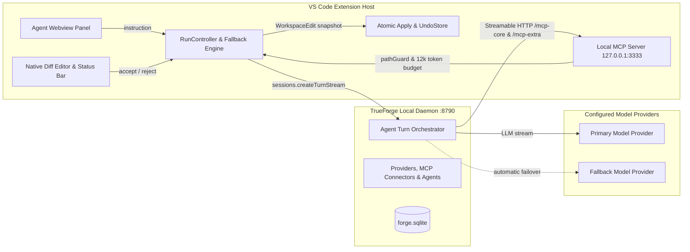

# ForgeTrail — Autonomous VS Code Coding Agent on TrueForge

> **Techfest 2026–27 TrueFoundry Forge-a-thon Submission**  
> **Team Name:** Mark-27 · **Team ID:** `TM-D8D4AED1C25` · **Institution:** Indian Institute of Technology Bombay (IIT Bombay)  
> **Write-Up (1–3 Page PDF):** [`ForgeTrail_Writeup.pdf`](ForgeTrail_Writeup.pdf) · **Markdown Source:** [`docs/writeup/WRITEUP.md`](docs/writeup/WRITEUP.md)

**ForgeTrail** is a local, model-independent Visual Studio Code coding assistant extension whose agent loop runs strictly on **TrueForge (`v0.184.2`)**. It exposes editor capabilities to TrueForge agents over **Model Context Protocol (MCP) Streamable HTTP** (`127.0.0.1:3333`), enforces a hard **12,000-token context retrieval budget**, gates every proposed file modification behind **VS Code's native split diff editor** (`forgetrail-proposed://`) via TrueForge `tool.approval_required` events, and automatically fails over across configured model providers when a primary model fails.

### Team Mark-27 (`TM-D8D4AED1C25`)

| Member | Role | GitHub & Email | Primary Ownership & Contributions |
| :--- | :--- | :--- | :--- |
| **Devesh Dolas** | Core Engine & MCP Server | [`@Dev-43`](https://github.com/Dev-43) | Local Streamable HTTP MCP server (`127.0.0.1:3333`), `pathGuard`, TrueForge SDK bridge, `RunController` state machine, atomic per-file `applyEdit` queue, byte-for-byte `undoStore`, and zero-write cancel guard. |
| **Aryan Fulari** | Context Engine, Agent Panel & Demo Video | [`@aryanfulari`](https://github.com/aryanfulari)<br>`aryanfulari@gmail.com` | 12,000-token retrieval budget engine (`budget.ts`), multi-bucket lexical file ranking (`suggest_context`), regex symbol extractor (`repo_outline`), `@file:` / `@symbol:` mention resolver, Agent Webview Panel & event mapper (`agentPanel.ts`, `eventMapper.ts`), dynamic multi-hunk inline selection expansion (`D-064`), benchmark execution, demo video recording, and video editing. |
| **Meghana Agnur** | API, Model Resilience, Overall Debugging & E2E Verification | [`@meghanaagnur`](https://github.com/meghanaagnur)<br>`meghanaagnur@gmail.com` | TrueForge provider, MCP connector, and agent registration (`scripts/setup.ts`), resilient multi-attempt failover & error classifier (`runWithFallback.ts`, `classifyError.ts`), client-side tool answering (`clientTools.ts`), model matrix benchmarking (`docs/model-matrix.md`), overall codebase debugging across Core/UI/MCP modules, and end-to-end verification & bug fixes (`scripts/verify.ts`, `D-049`–`D-063`). |
| **Vidyankshini Vibhute** | UI & Native Diff Review | [`@VIDYANKSHINI`](https://github.com/VIDYANKSHINI) | Native VS Code split diff review presenter (`ReviewController`), virtual document content provider (`forgetrail-proposed://`), inline `why` reason decorations, status bar manager, and user notifications. |

---

## 1. What it is

ForgeTrail delivers a safe, transparent, editor-native pair programming workflow inside VS Code:

- **Inline Editing Mode (`A1`)**: Select any code region, press `Ctrl+K Ctrl+E` (macOS: `Cmd+K Cmd+E`), and enter a natural-language instruction. ForgeTrail validates that proposals stay strictly inside the selected line bounds (dynamically expanding bounds across multi-hunk insertions) and opens each hunk in VS Code's native diff editor.
- **Autonomous Agent Mode (`A2`)**: Enter a high-level multi-file task in the **ForgeTrail Agent Panel** without naming any files. The agent discovers relevant source, test, and documentation files autonomously, streams its execution plan and tool trail in real time, and proposes changes hunk by hunk.
- **Budgeted Context Assembly (`B1`)**: Combines explicit `@file:<path>` and `@symbol:<name>` mentions with automatic lexical file ranking (`suggest_context`) and regex symbol signature extraction (`repo_outline`) under a strict **12,000-token retrieval budget**. The Agent Panel's **Context Chosen** card displays every selected file, its selection rationale, and exact token consumption before the first diff opens.
- **Native Diff Review & Byte-for-Byte Undo (`B2`)**: Every `propose_edit` call is held at TrueForge's approval gate (`tool.approval_required`). VS Code opens a native side-by-side diff (`vscode.diff`) decorated with an inline `◄ why:` explanation and title-bar **Accept (`✓`)** / **Reject (`✕`)** controls. Every applied edit records a pre-edit snapshot in `undoStore`, enabling instant rollback via **Undo Last Edit** (`undoLast`) or **Undo Run** (`undoRun`).
- **Zero-Write Mid-Stream Cancellation (`A3`)**: Clicking **Stop** (or the status bar item) aborts the active TrueForge turn in `< 100 ms`, terminates any active child process tree, closes pending review diffs, and guarantees zero partial or unapproved writes on disk.
- **Client-Side Resilient Model Failover (`B3`)**: Classifies runtime failures (401/403 auth errors, 404 model-not-found, 429 rate limits, 503/timeout transient failures, and repeated auto-denials) and automatically fails over from the primary TrueForge agent to the secondary fallback agent while preserving any hunks already applied.
- **Deep TrueForge Integration (`B4`)**: Uses two MCP Streamable HTTP connectors—`forgetrail-core` (`read_file`, `search_workspace`, `propose_edit`, `run_command`) and `forgetrail-extra` (`repo_outline`, `suggest_context`)—leveraging TrueForge's **deferred tool loading** (`list_tools`, `get_tool_info`, `call_tool`) and **Human-in-the-Loop (HITL) tool approval gating**.

### Architecture Overview



### Commands & Keyboard Shortcuts

| Command | Title | Keybinding (Windows / Linux) | Keybinding (macOS) |
| :--- | :--- | :--- | :--- |
| `forgetrail.inlineEdit` | **ForgeTrail: Inline Edit** | `Ctrl+K Ctrl+E` (or `Ctrl+K E` / `Ctrl+Alt+E`) | `Cmd+K Cmd+E` (or `Cmd+K E` / `Cmd+Alt+E`) |
| `forgetrail.openPanel` | **ForgeTrail: Open Agent Panel** | Command Palette (`Ctrl+Shift+P`) | Command Palette (`Cmd+Shift+P`) |
| `forgetrail.review.accept` | **ForgeTrail: Accept Hunk** (`✓`) | `Ctrl+K Ctrl+Y` (or `Ctrl+Alt+Y`) | `Cmd+K Cmd+Y` (or `Cmd+Alt+Y`) |
| `forgetrail.review.reject` | **ForgeTrail: Reject Hunk** (`✕`) | `Ctrl+K Ctrl+N` (or `Ctrl+Alt+N`) | `Cmd+K Cmd+N` (or `Cmd+Alt+N`) |
| `forgetrail.cancelRun` | **ForgeTrail: Cancel Run** | Status Bar click / Command Palette | Status Bar click / Command Palette |
| `forgetrail.undoLast` | **ForgeTrail: Undo Last Edit** | Notification button / Command Palette | Notification button / Command Palette |
| `forgetrail.undoRun` | **ForgeTrail: Undo Run** | Agent Panel button / Command Palette | Agent Panel button / Command Palette |

---

## 2. Requirements

- **Node.js**: Version `22.14.0` or newer (required by TrueForge `0.184.2`).
- **Python**: Version `3.10`, `3.11`, or `3.12` with `venv` (for the pinned Flask `3.1.3` benchmark repository).
- **Visual Studio Code**: Version `1.93.0` or newer.
- **Git**: Installed and available on system `PATH`.
- **TrueForge**: Pinned at `0.184.2` (`@truefoundry/trueforge@0.184.2`, client SDK `@truefoundry/trueforge-sdk@0.184.1`).

---

## 3. Setup from a clean clone

Follow these steps to build, configure, and run ForgeTrail from a fresh clone:

1. **Clone the repository and install dependencies**:
   ```bash
   git clone https://github.com/Dev-43/forgetrail.git
   cd forgetrail
   npm install
   npm run compile
   ```

2. **Create your local `.env` file** (git-ignored; never commit API keys):
   ```bash
   cp .env.example .env
   ```
   Populate `.env` with your provider API keys (`GEMINI_API_KEY`, `SECONDARY_API_KEY`, `NVIDIA_API_KEY`) and optional `FLASK_DIR` (defaults to `./dev/forge-spike/flask`).

3. **Create your local model configuration**:
   ```bash
   cp config/models.example.json config/models.json
   ```

4. **Start the local TrueForge server daemon** (keep running in Terminal 1):
   ```bash
   npm run trueforge
   ```
   *Starts `@truefoundry/trueforge@0.184.2` in standalone SQLite mode on `http://localhost:8790` with allowed outbound hosts configured from `config/models.json`.*

5. **Register providers, MCP connectors, and agents** (in Terminal 2):
   ```bash
   npm run setup
   ```
   *Verifies TrueForge reachability, registers configured model providers, registers `/mcp-core` and `/mcp-extra` connectors on `http://127.0.0.1:3333`, upserts all four agents (`forgetrail-inline-primary`, `forgetrail-inline-fallback`, `forgetrail-agent-primary`, `forgetrail-agent-fallback`), and executes live smoke tests (`PASS smoke-primary`, `PASS smoke-fallback`).*

6. **Launch the Extension Development Host in VS Code**:
   - Open this repository in VS Code (`code .`) and press **F5** (or **Run > Start Debugging**).
   - In the newly opened `[Extension Development Host]` window, open the pinned Flask workspace (`dev/forge-spike/flask`).

---

## 4. Flask setup

The three fixed competition tasks run against `pallets/flask` at release tag **`3.1.3`** (commit `22d92470`). Detailed instructions are also available in [`docs/flask-setup.md`](docs/flask-setup.md):

```bash
# 1. Clone pallets/flask and check out tag 3.1.3 (commit 22d92470)
mkdir -p dev/forge-spike
git clone https://github.com/pallets/flask.git dev/forge-spike/flask
cd dev/forge-spike/flask
git checkout 3.1.3
git rev-parse --short HEAD   # must start with 22d92470

# 2. Create and activate a Python virtual environment inside the Flask directory
python3 -m venv .venv
source .venv/bin/activate    # Windows PowerShell: .venv\Scripts\Activate.ps1

# 3. Install Flask in editable mode and test dependencies
pip install --upgrade pip
pip install -e .
pip install "pytest<9" asgiref greenlet python-dotenv

# 4. Confirm baseline CLI tests pass (58 passed)
pytest tests/test_cli.py -q
cd ../../..
```

To reset the Flask repository back to a clean tag `3.1.3` state at any time (preserving `.venv`):
```bash
npm run reset:flask
```

---

## 5. Run the three tasks

ForgeTrail ships with automated runners and on-screen verification scripts for all three competition benchmarks:

- **Task A — Inline Edit (`src/flask/helpers.py` `get_debug_flag`)**:
  - *In VS Code*: Open `src/flask/helpers.py`, select `get_debug_flag` (lines 28–33), press `Ctrl+K Ctrl+E` (`Cmd+K Cmd+E`), and instruct:
    > `Treat the values 'off' and 'n' as false as well, case-insensitively, and update the docstring to list every value that is treated as false.`
  - *Headless runner & verification*:
    ```bash
    npm run test:task-a
    npm run verify:a
    # Or raw check in dev/forge-spike/flask:
    FLASK_DEBUG=off python -c "from flask.helpers import get_debug_flag; print(get_debug_flag())"
    # -> False
    ```

- **Task B — Autonomous Agent Mode (Built-in `flask config` CLI command across 3+ files)**:
  - *In VS Code*: Open **ForgeTrail: Open Agent Panel** and instruct (with no files mentioned):
    > `Add a new built-in CLI command flask config that prints the loaded application's configuration as JSON, masking the values of any key containing SECRET, PASSWORD, TOKEN or KEY as "***". It must appear in flask --help, be covered by a test, and be documented alongside the other built-in commands.`
  - *Headless runner & verification*:
    ```bash
    npm run test:task-b
    npm run verify:b
    ```
    *Verifies 4 criteria: `git diff` touches $\ge 3$ files (`src/flask/cli.py`, `tests/test_cli.py`, `docs/cli.rst`), `pytest tests/test_cli.py -q` passes, `flask --app demo/app.py config` masks sensitive keys as `"***"`, and `flask --help` lists `config`.*

- **Task C — Resilience, Model Failover & Clean Workspace Verification**:
  ```bash
  # Break the primary provider key to demonstrate automatic failover to the fallback model:
  npm run setup -- --break-primary
  npm run test:task-c
  npm run verify:c
  # Restore valid keys for all four agents:
  npm run setup -- --restore
  ```

- **Unit Tests & Pre-Submission Audit**:
  ```bash
  npm test        # Runs all 73 unit and integration tests
  npm run check   # Runs all 11 pre-submission integrity checks
  ```

---

## 6. Models and switching

ForgeTrail is strictly model-independent: there are **zero provider names** anywhere in `src/` (enforced automatically by `npm run check`). All provider and model routing lives in `config/models.json` and is registered into TrueForge via `npm run setup`.

- **Switch models via `config/models.json`**:
  Edit `models.primary`, `models.fallback`, and `models.agentFallback` using `<provider>/<model id>` and run `npm run setup`.
- **Switch models for a single setup run via CLI flags**:
  ```bash
  npm run setup -- --primary <provider>/<model id> --fallback <provider>/<model id>
  ```
- **Simulate primary provider failure (Task C)**:
  ```bash
  npm run setup -- --break-primary
  ```
- **Restore normal provider configuration**:
  ```bash
  npm run setup -- --restore
  ```

---

## 7. Starting point

**From scratch — no upstream project was forked.**

ForgeTrail was designed and implemented from an empty Git repository initialized specifically for the Techfest 2026–27 TrueFoundry Forge-a-thon. All subsystems—including the Streamable HTTP MCP server, the 12,000-token budgeted lexical context retriever, the native VS Code virtual diff presenter (`forgetrail-proposed://`), the per-file serialized apply queue, the byte-for-byte undo stack, and the multi-attempt fallback controller—were written from first principles.

---

## 8. Licence and credits

- **Licence**: Released under the [MIT License](LICENSE).
- **Credits**:
  - Agent runtime harness powered by [TrueForge](https://github.com/truefoundry/trueforge) (`v0.184.2`, MIT License) and `@truefoundry/trueforge-sdk` (`v0.184.1`).
  - Editor tool transport built with `@modelcontextprotocol/sdk` (Model Context Protocol Streamable HTTP).
  - Evaluated on [Pallets Flask](https://github.com/pallets/flask) (`v3.1.3`, BSD-3-Clause).

---

## 9. Models used and cost

All models are registered in TrueForge as builtin catalog providers or OpenAI-compatible endpoints via `config/models.json` (see [`docs/model-matrix.md`](docs/model-matrix.md) for full latency and tool-calling benchmarks):

| Agent Role | Configured Models Tested & Declared | Provider / Endpoint | Cost |
| :--- | :--- | :--- | :--- |
| **Primary (`forgetrail-*-primary`)** | `google-gemini/gemini-3-6-flash`<br>`google-gemini/gemini-3-5-flash-lite`<br>`nvidia/nvidia/nemotron-3.5-super-vl-120b-a12b` | Google AI Studio (Catalog, Free Tier)<br>NVIDIA NIM (`integrate.api.nvidia.com/v1`, Free Trial Credits) | **$0.00** |
| **Inline Fallback (`forgetrail-inline-fallback`)** | `groq/qwen/qwen3.8-27b`<br>`google-gemini/gemini-3-1-flash-lite` | Groq (`api.groq.com/openai/v1`, Free Tier)<br>Google AI Studio (Catalog, Free Tier) | **$0.00** |
| **Agent Fallback (`forgetrail-agent-fallback`)** | `nvidia/mistralai/mistral-large-4-1t-a52b`<br>`groq/qwen/qwen3.8-27b` | NVIDIA NIM (`integrate.api.nvidia.com/v1`, Free Credits)<br>Groq (`api.groq.com/openai/v1`, Free Tier) | **$0.00** |

- **Total Compute Cost**: **$0.00** across all development, testing, and benchmark recordings (100% free-tier API quotas).
- **Minimum Model Requirements**: Tool/function calling support and a context window of at least 32,000 tokens.

---

## 10. Known limitations

1. **Free-Tier Rate Limits on Multi-Turn Runs**: Task B requires 20–30 tool calls across 6–8 turns. Free-tier endpoints (15 RPM on Google AI Studio; 6,000–12,000 TPM on Groq) can return HTTP `429` or `503` spikes mid-run. ForgeTrail mitigates this by pacing MCP tool execution at `4.5 s` (`MIN_TOOL_INTERVAL_MS` in `src/mcp/server.ts`) and automatically backing off or failing over to the fallback agent.
2. **TrueForge 20-Second Header Timeout**: TrueForge `0.184.2` standalone mode enforces a fixed 20-second response header timeout (`UND_ERR_HEADERS_TIMEOUT`), causing slow reasoning models to time out and trigger fallback.
3. **Post-Edit Verification Not Auto-Gated**: While the agent runs `pytest` via `run_command` during Task B, ForgeTrail does not force a mandatory test-pass gate before marking a run `done`.
4. **Single Active Run Concurrency**: Only one run executes at a time because MCP tool requests do not carry a TrueForge session identifier; budget and cancellation state are bound to the active run context.
5. **Regex Symbol Outlines**: `repo_outline` extracts class/function definitions via regex for Python, TypeScript, and JavaScript; other languages rely on `search_workspace` and lexical scoring.
