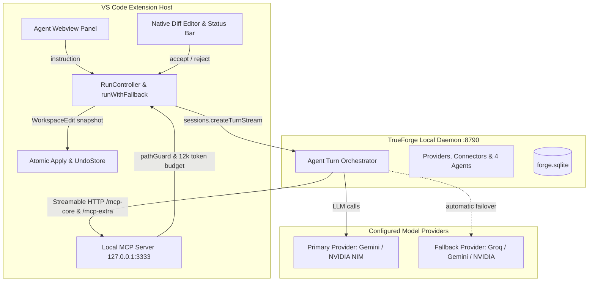

# ForgeTrail — Techfest 2026-27 Forge-a-thon Submission Write-Up

**Team Name:** Mark-27 · **Team ID:** `TM-D8D4AED1C25` · **Institution:** Indian Institute of Technology Bombay (IIT Bombay)  
**Repository:** [https://github.com/Dev-43/forgetrail](https://github.com/Dev-43/forgetrail)

---

## 1. Team

| Name | Role | GitHub & Email | Primary Responsibilities |
|---|---|---|---|
| **Devesh Dolas** | Core Engine & MCP Server | [`@Dev-43`](https://github.com/Dev-43) | MCP HTTP Server (`:3333`), `pathGuard`, TrueForge SDK session bridge, `RunController` state machine, atomic per-file `applyEdit` queue, byte-for-byte `undoStore`, and zero-write cancel guard. |
| **Aryan Fulari** | Context Engine, Agent Panel & Demo Production | [`@aryanfulari`](https://github.com/aryanfulari) `aryanfulari@gmail.com` | 12,000-token retrieval budget engine (`src/mcp/budget.ts`), multi-bucket lexical file ranking (`suggest_context`), regex symbol signature extractor (`repo_outline`), `@file:` / `@symbol:` mention resolver (`src/context/*`), Agent Webview Panel & streaming event mapper (`src/panel/*`, `eventMapper.ts`), dynamic multi-hunk inline selection expansion (`D-064`), benchmark execution, demo video recording, and video editing. |
| **Meghana Agnur** | API, Model Resilience, Overall Debugging & E2E Verification | [`@meghanaagnur`](https://github.com/meghanaagnur) `meghanaagnur@gmail.com` | TrueForge provider/connector/agent registration (`scripts/setup.ts`), resilient multi-attempt failover & error classifier (`runWithFallback.ts`, `classifyError.ts`), client-side tool answering (`clientTools.ts`), model matrix benchmarking (`docs/model-matrix.md`), overall codebase debugging across Core/UI/MCP modules, and end-to-end verification & bug fixes (`scripts/verify.ts`, `D-049`–`D-063`). |
| **Vidyankshini Vibhute** | UI & Native Diff Review | [`@VIDYANKSHINI`](https://github.com/VIDYANKSHINI) | Native VS Code diff review presenter (`ReviewController`), virtual document provider (`forgetrail-proposed://`), inline `why` decorations, status bar manager, and notifications. |
| **Pranav Gaikwad** | Config Templates | [`@Pranav1632`](https://github.com/Pranav1632) | Initial `.env.example` and `config/models.example.json` configuration templates. |

- **Team Name & ID:** Team **Mark-27** (`TM-D8D4AED1C25`)
- **College / Institution:** Indian Institute of Technology Bombay (IIT Bombay)

---

## 2. Starting Point

**From scratch — no upstream project was forked.**

ForgeTrail was conceived, architected, and built entirely from an empty Git repository initialized for the Techfest 2026-27 TrueFoundry Forge-a-thon:
- **No Upstream Templates or Boilerplate Forks**: Built directly on standard VS Code Extension APIs (`^1.93.0`) with strict TypeScript compilation (`tsconfig.json`).
- **No Third-Party Diff Clones**: Uses VS Code's native split diff editor (`vscode.diff`) backed by a virtual document provider (`forgetrail-proposed://`), inline decorations for the agent's per-hunk reasoning, and native editor title-bar actions.
- **Zero Copied Code**: The Streamable HTTP MCP server, lexical context retrieval engine, regex symbol outline extractor, per-file serialized apply queue, byte-for-byte undo stack, and client-side failover controller were written from first principles.

---

## 3. Architecture on TrueForge

### How the Extension Talks to TrueForge & Which Harness Features Are Used
1. **TrueForge SDK & Session Streaming**: The VS Code Extension Host communicates strictly with the local TrueForge daemon (`@truefoundry/trueforge@0.184.2` on `http://localhost:8790`) via `@truefoundry/trueforge-sdk@0.184.1` (`client.sessions.create`, `createTurnStream`, `cancel`). The extension never calls any LLM provider directly.
2. **Two Streamable HTTP MCP Connectors (`127.0.0.1:3333`) & Deferred Tool Loading**:
   - **`forgetrail-core` (`/mcp-core`, preloaded)**: Exposes `read_file`, `search_workspace`, `propose_edit`, and `run_command`.
   - **`forgetrail-extra` (`/mcp-extra`, `deferred_loading: true`)**: Exposes `repo_outline` and `suggest_context`. In Agent Mode, TrueForge uses its built-in deferred meta-tools (`list_tools`, `get_tool_info`, `call_tool`) to load `/mcp-extra` schemas on demand, saving prompt tokens on simple turns.
   - Each endpoint multiplexes connections by `mcp-session-id` so multi-turn and multi-tool batches never collide.
3. **Human-in-the-Loop (HITL) Tool Approval Gating**: Both `propose_edit` and `run_command` are registered with `requires_approval` in the four TrueForge agent manifests (`agents/*.json`). When the model proposes an edit, TrueForge pauses the turn and emits `tool.approval_required`. `RunController` validates the proposal against workspace path guards and inline selection bounds, opens VS Code's native split diff editor (`forgetrail-proposed://`), waits for the user's **Accept (`✓`)** or **Reject (`✕`)** decision (with optional rejection feedback), and resumes the TrueForge turn with `allow` or `deny`.
4. **Zero-Write Cancel & Process Cleanup**: Calling `cancelRun()` sets a synchronous cancel flag (`runContext.cancel()`), calls `client.sessions.cancel()`, disposes open review tabs, and kills any active child process tree (`taskkill /T /F` on Windows; `SIGKILL` on POSIX), ensuring `< 100 ms` cancellation and zero partial writes.

---

## 4. How Context is Selected

ForgeTrail uses a fast, deterministic, budgeted lexical retrieval pipeline with **zero external embedding API dependencies**:

1. **Hard 12,000-Token Retrieval Budget (`RUN_RETRIEVAL_MAX_TOKENS = 12000`)**: Every retrieval tool (`read_file`, `search_workspace`, `repo_outline`, `suggest_context`) estimates tokens as `ceil(chars / 4)` and deducts from the run's 12,000-token budget. Every tool response header reports `[... | ~N tokens | budget left M]`. Once exhausted, further reads return `E_BUDGET`, forcing the agent to synthesize its plan and propose edits from gathered context.
2. **Multi-Category Lexical File Ranking (`suggest_context`)**: Tokenizes the user's task description, strips stopwords, and scores workspace files across three buckets—**Source files** (`src/`, `flask/`), **Tests** (`tests/`), and **Documentation** (`docs/`)—by filename, path, and content keyword frequency. Returns up to 8 top-ranked files (`SUGGEST_MAX_FILES = 8`) with explicit selection reasons and token estimates.
3. **Regex Symbol Outlines (`repo_outline`)**: Extracts `class`, `def`, and `function` signatures with 1-based line numbers across Python, TypeScript, and JavaScript, ranked by keyword hits and capped at **1,500 tokens** (`OUTLINE_MAX_TOKENS`).
4. **Explicit `@file:` and `@symbol:` Mentions**: Users can pin `@file:<path>` (up to 200 lines plus an automatic symbol outline of the remainder) or `@symbol:<name>` (locates the symbol definition block and exact line range across the repo). Both are injected under `ATTACHED CONTEXT` and surfaced alongside agent-read files in the Agent Panel's **Context Chosen** card.

---

## 5. Model Setup

### Declared Models, Where They Ran, and Cost

All models are configured in TrueForge (as catalog providers or OpenAI-compatible endpoints) by `npm run setup` reading `config/models.json`. There are **zero provider names in `src/`**.

| Agent Role | Model Identifier | Provider & Where It Ran | Cost |
|---|---|---|---|
| **Primary — Inline & Agent (`forgetrail-*-primary`)** | `google-gemini/gemini-3-6-flash` `google-gemini/gemini-3-5-flash-lite` `nvidia/nvidia/nemotron-3.5-super-vl-120b-a12b` | Google AI Studio (TrueForge builtin catalog, free tier) NVIDIA NIM (`https://integrate.api.nvidia.com/v1`, free trial credits) | **$0.00** |
| **Inline Fallback (`forgetrail-inline-fallback`)** | `groq/qwen/qwen3.8-27b` `google-gemini/gemini-3-1-flash-lite` | Groq (`https://api.groq.com/openai/v1`, OpenAI-compatible free tier) Google AI Studio (TrueForge builtin catalog, free tier) | **$0.00** |
| **Agent-Mode Fallback (`forgetrail-agent-fallback`)** | `nvidia/mistralai/mistral-large-4-1t-a52b` `groq/qwen/qwen3.8-27b` | NVIDIA NIM (`https://integrate.api.nvidia.com/v1`, free trial credits) Groq (`https://api.groq.com/openai/v1`, OpenAI-compatible free tier) | **$0.00** |

*Total inference cost across development, testing, and video recording: **$0.00** (100% free tiers).*

### How a User Switches Models
1. Place the provider's API key in `.env` (e.g., `GEMINI_API_KEY`, `NVIDIA_API_KEY`, `SECONDARY_API_KEY`).
2. In `config/models.json`, list the provider under `providers` (`"builtin"` for a TrueForge catalog provider or `"openai-compatible"` with `baseUrl` and `models[]`) and point `models.primary`, `models.fallback`, and `models.agentFallback` to `<provider>/<model id>`.
3. Run `npm run setup` (or override via CLI without editing files: `npm run setup -- --primary <provider>/<model id> --fallback <provider>/<model id>`). Setup registers the providers in TrueForge, upserts all four agents, and verifies both with live turn streams (`PASS smoke-primary`, `PASS smoke-fallback`).

---

## 6. Scorecard

| Criterion | Video Timestamp | One-Line Claim |
|---|---|---|
| **Eligibility Gate** | `2:45–2:58` | Agent loop runs strictly on local TrueForge `0.184.2`; editor tools are MCP tools on `127.0.0.1:3333`; Task B session shown; agent definitions in `agents/`. |
| **A1 Inline edit** | `0:08–0:24` | Selection in `helpers.py` + `Cmd+K Cmd+E` + instruction opens a native split diff per hunk with inline `why` reason and Accept/Reject controls; verified `False` at `0:34–0:39`. |
| **A2 Agent mode** | `1:04–2:30` | Single unprompted panel request discovers and edits 3 files (`src/flask/cli.py`, `tests/test_cli.py`, `docs/cli.rst`) and passes all 4 verification checks at `2:41–2:45`. |
| **A3 Streaming + cancel** | `1:16–1:44`, `3:38–3:42` | Plan, context, and tool calls stream live into the panel; clicking **Stop** mid-run at `3:41` halts immediately (`0 applied, 0 discarded`) with a clean `git status`. |
| **B1 Context assembly** | `1:42–1:52` | `suggest_context` and `read_file` operate under the 12,000-token budget (`9,289 / 12,000` used); **Context Chosen** card displays selected files, reasons, and token counts before the first diff. |
| **B2 Diff safety** | `0:18–0:24`, `0:40–0:51` | Every hunk is gated in the native diff editor before touching disk; **ForgeTrail: Undo Run** at `0:40` reverts `helpers.py` byte-for-byte (`PASS workspace unchanged`). |
| **B3 Resilience (Task C)** | `3:01–3:27` | After `npm run setup -- --break-primary` (401 on primary), running Task A automatically switches the status bar to `forgetrail-inline-fallback`, renders the fallback diff, and leaves the workspace clean upon reject (`verify:c` PASS). |
| **B4 TrueForge depth** | `1:16–1:20`, `2:45–2:58` | TrueForge HITL tool approval drives diff review; deferred MCP tool loading (`forgetrail-extra` via `list_tools`/`get_tool_info`/`call_tool`) and 8-turn / 30-tool-call trace shown in the TrueForge UI. |
| **C1 Video** | `0:02`, `0:34–0:39`, `2:41–2:45`, `3:22–3:27` | Under 4 minutes (`3:47`); Tasks A, B, and C demonstrated in order, uncut from instruction to first diff, each verified on screen. |
| **C2 Write-up** | — | This document (`ForgeTrail_Writeup.pdf` / `docs/writeup/WRITEUP.md`), backed by architectural log `DECISIONS.md` (`D-001` to `D-064`). |

---

## 7. Tools Used

In accordance with competition rules, all software tools, libraries, and AI coding assistants used to build ForgeTrail are disclosed below:
- **Runtime & IDE**: Visual Studio Code (`^1.93.0`), Node.js (`v22.17+` / `v26.8`), TypeScript `5.7.3` (`strict: true`), `tsx` script runner, Python `3.12` virtual environment with `pytest` (`<9`) on `pallets/flask` tag `3.1.3`.
- **Agent Harness & Protocol SDKs**: `@truefoundry/trueforge` (`0.184.2` local standalone SQLite daemon), `@truefoundry/trueforge-sdk` (`0.184.1`), `@modelcontextprotocol/sdk` (`^1.32.2` Streamable HTTP transport), and `zod` (`^3.24.2`).
- **AI Coding Assistants**:
  - **Claude (Anthropic)**: Used during initial architecture planning and contract specification (`D-001`).
  - **Antigravity (Google DeepMind)**: Used across Milestones M0–M4 for pair-programming implementation, MCP server wiring, native diff presentation, fallback logic, and automated test suites (logged turn-by-turn in `DECISIONS.md` Part 5).

---

## 8. Known Limitations

1. **Free-Tier Quotas on Long Multi-File Runs**: Task B requires 20–30 tool calls across 6–8 turns. Free-tier providers (15 RPM on Google AI Studio; 6k–12k TPM on Groq) can hit HTTP `429` or `503` mid-run. ForgeTrail paces MCP tool execution at `4.5 s` (`MIN_TOOL_INTERVAL_MS`) and automatically backs off or switches to the fallback model, though simultaneous exhaustion of both free tiers will terminate a run with `S_NO_FALLBACK`.
2. **Fixed 20-Second TrueForge Header Timeout**: TrueForge `0.184.2` standalone mode enforces a 20-second HTTP headers timeout (`UND_ERR_HEADERS_TIMEOUT`); slow reasoning models that take $>20\text{ s}$ before emitting the first token time out and trigger fallback.
3. **Model Output Quality vs. Automatic Test Gate**: While the agent calls `run_command` to run `pytest` during Task B, ForgeTrail does not enforce a mandatory post-apply test harness gate before allowing the agent to declare completion.
4. **Single Active Run Concurrency**: Only one run can execute at a time because MCP tool requests do not carry a TrueForge session ID; budget and cancel state are scoped to the active run.
5. **Regex Symbol Outlines**: `repo_outline` supports Python, TypeScript, and JavaScript via regex; other languages fall back to `search_workspace` and lexical keyword scoring.

### What We Would Do With Another Month
- **Automated Test-and-Repair Loop**: Run relevant `pytest` / unit test suites automatically before a turn completes and feed any failure traceback back into the TrueForge session.
- **Mid-Run Session Continuation on Failover**: Carry the structured conversation transcript directly into the fallback session rather than restarting with an `ALREADY APPLIED` summary list.
- **Tree-Sitter AST Outlines & Call-Graph Ranking**: Replace regex outlines with Tree-Sitter grammars across 15+ languages and weight `suggest_context` by import/call-graph proximity.
- **Multi-File Pending Hunks Sidebar & CodeLens**: Add a dedicated VS Code activity-bar tree view listing all queued hunks across files with inline CodeLens Accept/Reject actions.
