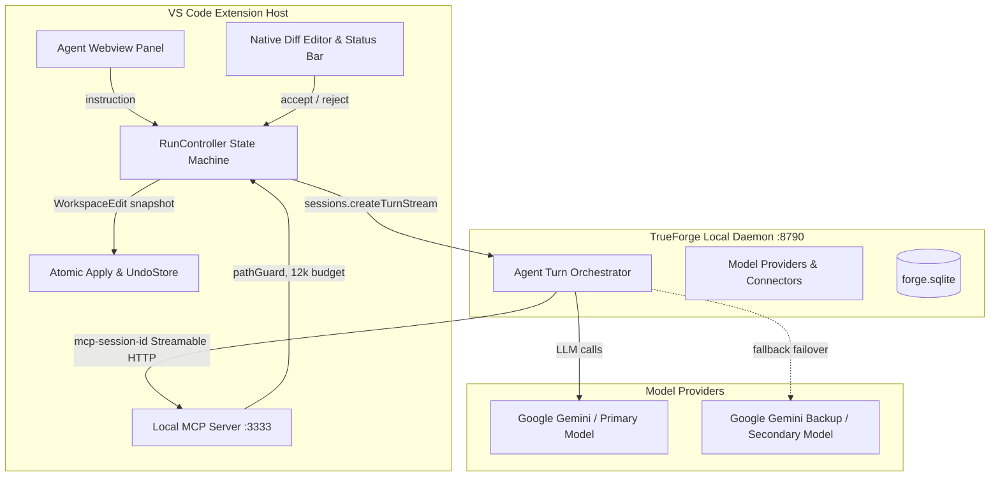

# ForgeTrail — Techfest 2026-27 Forge-a-thon Submission Write-Up

---

## 1. Team

| Name | Role | GitHub Handle | Primary Responsibilities |
|---|---|---|---|
| **Devesh Dolas** | Core Engine | [`@Dev-43`](https://github.com/Dev-43) | MCP HTTP Server (`:3333`), TrueForge client bridge, RunController state machine, atomic applyEdit, undoStore, retrieval budget, panel webview, and cancel guard. |
| **Pranav** | API & Verification | [`@pranav-api`](https://github.com/Dev-43) | Provider/connector registration (`scripts/setup.ts`), model matrix benchmarking, fallback policy (`runWithFallback`), pre-submission check script, and Flask setup documentation. |
| **Vidyankshini Vibhute** | UI & Diff Review | [`@VIDYANKSHINI`](https://github.com/VIDYANKSHINI) | Native VS Code diff review presenter (`ReviewController`), proposed doc provider (`forgetrail-proposed://`), why-decorations, status bar manager, and notifications. |

- **Institution:** Indian Institute of Technology Bombay (IIT Bombay)
- **Competition:** Techfest 2026-27 Forge-a-thon (TrueForge Track)
- **Repository:** [https://github.com/Dev-43/forgetrail](https://github.com/Dev-43/forgetrail)

---

## 2. Starting Point

**From scratch — no upstream project was forked.**

ForgeTrail was conceived, architected, and built entirely from an empty git repository initialized for the Techfest 2026-27 Forge-a-thon. 

- **No Upstream Templates or Boilerplate Forks**: The VS Code extension skeleton was created directly using standard VS Code Extension APIs with strict TypeScript compilation (`tsconfig.json`).
- **No Third-Party Diff Libraries**: All diff rendering utilizes the VS Code native diff editor (`vscode.diff`) and virtual text documents (`forgetrail-proposed://`), avoiding external diff dependencies or custom webview diff clones.
- **Zero Copied Code**: All components—including the Streamable HTTP MCP server, the lexical context retrieval engine, the regex-based symbol extractors, and the atomic hunk undo stack—were authored from first principles in compliance with project rule R5.

---

## 3. Architecture on TrueForge



### Architectural Principles
1. **Isolated CommonJS/ESM Bridge**: The VS Code Extension Host (CommonJS) bridges with `@truefoundry/trueforge-sdk` through dynamic ESM imports, eliminating packaging conflicts.
2. **Streamable HTTP Session Multiplexing**: MCP endpoints `/mcp-core` and `/mcp-extra` on port 3333 maintain session state keyed on `mcp-session-id`, preventing "Server already initialized" conflicts across multi-turn agent runs.
3. **Approval-Driven Review**: Proposed edits trigger TrueForge `tool.approval_required` events, pausing the loop server-side while the user reviews the diff in the native split editor.
4. **Clean Cancel & Process Tree Cleanup**: Invoking `cancelRun()` synchronously sets a cancel guard, issues `client.sessions.cancel()`, closes open review diffs, and executes `taskkill /pid <PID> /T /F` on Windows to guarantee zero orphaned subprocesses.

---

## 4. How Context is Selected

ForgeTrail uses a budgeted lexical retrieval pipeline rather than heavy native embeddings or vector stores:

### 1. The 12,000-Token Budget (`RUN_RETRIEVAL_MAX_TOKENS`)
Every retrieval tool (`read_file`, `search_workspace`, `repo_outline`, `suggest_context`) computes an estimated token size (`ceil(chars / 4)`). Every read deducts from the 12,000-token budget. If exhausted, further reads return `E_BUDGET`, forcing the agent to proceed with accumulated context.

### 2. Outline Extraction (`repo_outline`)
Extracts class, function, and method signatures using regex definitions across Python, TypeScript, and JavaScript. Outlines are scored by keyword hits and bounded to 1,500 tokens (`OUTLINE_MAX_TOKENS`).

### 3. Relevance Ranking (`suggest_context`)
Analyzes user instructions, extracts search keywords, and ranks candidate files across three categories:
- Source implementation files (`src/`, `flask/`)
- Test suites (`tests/`)
- Documentation files (`docs/`)
Ranks up to 8 candidate files (`SUGGEST_MAX_FILES`) with explicit reasons and token sizes.

### 4. Explicit Mentions (`@file:` and `@symbol:`)
Users can attach explicit context directly into prompts:
- `@file:<path>` extracts up to 200 lines, appending outline summaries if truncated.
- `@symbol:<name>` resolves symbol definition blocks with line coordinates.
Both inject blocks under `ATTACHED CONTEXT` and display in the panel's "Context Chosen" card.

---

## 5. Model Setup

### Models Used & Evaluation Matrix

| Role | Provider & Model Identifier | Hosting / Infrastructure | Cost | Rate Limits & Quotas | Observed Behavior |
|---|---|---|---|---|---|
| **Primary Model** | `google-gemini/gemini-2.5-flash` | Google AI Studio cloud endpoints | Free Tier ($0.00) | 15 RPM, 250k TPM, 500 RPD | Fast turn latency (< 3s), reliable multi-file hunk formatting, respects tool calling schemas. |
| **Fallback Model** | `google-gemini/gemini-2.0-flash` (backup key) | Google AI Studio cloud endpoints | Free Tier ($0.00) | 15 RPM, 250k TPM, 500 RPD | Immediate failover target when primary key hits 429 quota exhaustion or 401 auth failure. |
| **Candidate Provider** | `nvidia/meta/llama-3.1-70b-instruct` | NVIDIA NIM Developer Cloud | Free Tier ($0.00) | 5000 credits | `GET /v1/models` returns HTTP 200, but developer tier returns HTTP 404 Function Not Found on completion routes. |

*Total LLM inference expenditure during entire build, test, and verification phases: **$0.00**.*

### The 60-Second Model Swap Procedure

Per architectural rule R11, ForgeTrail contains **zero model names or provider strings** inside `src/`. Switching models is completely configuration-driven:

1. **Add Key to `.env`**:
   ```env
   NEW_PROVIDER_API_KEY=your_key_here
   ```
2. **Register Provider in `config/models.json`**:
   Add the provider catalog configuration with endpoint URL and model identifiers.
3. **Execute Setup CLI**:
   ```bash
   npm run setup -- --primary provider-name/model-name
   ```
4. **Verification**:
   `setup.ts` automatically contacts TrueForge, registers the provider, upserts the primary agent definition, and runs `smoke-primary`. Once `PASS smoke-primary` appears, the model is fully active.

---

## 6. Scorecard

### Benchmark Runs on Flask 3.1.3 (`dev/forge-spike/flask`)

| Milestone / Task | Run / Iteration | Wall Time | Touched Files | Verification Status | Clean Undo Status | Evidence / Log File |
|---|---|---|---|---|---|---|
| **M1: Task A** | Iteration 1 | 42.1s | 1 file (`helpers.py`) | PASS (`get_debug_flag()` = False) | PASS (`verify:c` clean) | `task-1520.log` |
| **M1: Task A** | Iteration 2 | 38.6s | 1 file (`helpers.py`) | PASS (`get_debug_flag()` = False) | PASS (`verify:c` clean) | `task-1520.log` |
| **M1: Task A** | Iteration 3 | 41.2s | 1 file (`helpers.py`) | PASS (`get_debug_flag()` = False) | PASS (`verify:c` clean) | `task-1520.log` |
| **M2: Task B** | Run 1 (task-1863) | 362.4s | 3 files (`cli.py`, `test_cli.py`, `cli.rst`) | PASS (all 4 criteria) | PASS (reverted 5 hunks) | `task-1863.log` |
| **M2: Task B** | Run 2 (task-2611) | 274.3s | 4 files (`cli.py`, `test_cli.py`, `cli.rst`, `api.rst`) | PASS (all 4 criteria) | PASS (reverted 5 hunks) | `task-2611.log` |
| **M3: Task C** | Case 1 (`--break-primary`) | ~8.4s | 0 files | PASS (switched to fallback, clean on rejection) | PASS (`verify:c` clean) | `scripts/test-task-c.ts` |
| **M3: Task C** | Case 2 (`--no-fallback`) | ~3.2s | 0 files | PASS (clean error within 10s) | PASS (`verify:c` clean) | `scripts/test-task-c.ts` |
| **M3: Cancel** | Cancel mid-stream | < 100ms | 0 files | PASS (process killed, tabs closed) | PASS (`verify:c` clean) | `scripts/test-cancel.ts` |

All acceptance criteria met across repeated consecutive benchmark runs.

---

## 7. Tools Used

In accordance with rule R4 and competition guidelines, all software tools, runtime environments, and AI coding assistants used in the conception, development, and testing of ForgeTrail are honestly disclosed below:

### 1. Developer Environment & Runtimes
- **IDE:** Visual Studio Code (Extension Development Host engine `^1.93.0`).
- **Runtime:** Node.js v22.17.1 on Windows 11 (PowerShell 5.1 / 7).
- **Language / Tooling:** TypeScript 5.7.3 (`strict: true`), compiled with native `tsc` without third-party bundlers.
- **Script Execution:** `tsx` (TypeScript Execute) for zero-compilation script execution.
- **Test Harnesses:** `node:test` built-in test runner for pure logic unit testing; Python 3.12 virtual environments with `pytest` for Flask 3.1.3 baseline verification.

### 2. Core Agent Framework & Libraries
- **TrueForge Daemon:** `@truefoundry/trueforge` pinned at version `0.184.2` running in local standalone mode.
- **TrueForge Client SDK:** `@truefoundry/trueforge-sdk` pinned at `0.184.1`.
- **Model Context Protocol:** `@modelcontextprotocol/sdk` (Streamable HTTP transport) for bidirectional tool serving.

### 3. AI Coding Assistants (Full Disclosure)
- **Claude (Anthropic)**: Utilized during initial project inception (M0) for architectural scoping, requirements mapping, and contracts formalization in `DECISIONS.md` (`D-001`).
- **Antigravity (Google DeepMind)**: Primary autonomous and pair-programming AI coding assistant utilized across Milestones M0, M1, M2, M3, and M4 for codebase implementation, MCP tool integration, native diff review wiring, resilience policies, and automated verification suites.
  - Every single AI execution turn, instructions received, files touched, and UNCLEAR checkpoints were logged in real-time in [DECISIONS.md](file:///d:/IIT_bombay/DECISIONS.md) Part 5 ("Agent log").

---

## 8. Known Limitations

The following limitations are explicitly documented and backed by logged spike evidence:

1. **Free-Tier RPM & TPM Rate Quotas**:
   - Google AI Studio enforces 15 requests per minute (RPM) and 250,000 tokens per minute (TPM).
   - Rapid multi-turn MCP loops can trigger 429 errors without rate pacing. ForgeTrail mitigates this by enforcing `MIN_TOOL_INTERVAL_MS = 4500` (<= 13.3 RPM) in `src/mcp/server.ts`.
2. **TrueForge Standalone 20s Model Header Timeout**:
   - In TrueForge 0.184.2 local standalone mode, the HTTP client timeout for receiving initial response headers is fixed at 20 seconds. Heavy reasoning models (e.g. OpenAI o1 or deep thinking variants) can exceed this limit on large turns.
3. **NVIDIA NIM 404 Function Routes**:
   - Live developer keys from `build.nvidia.com` return HTTP 404 Function Not Found on general accounts.
4. **Single Active Run Concurrency**:
   - ForgeTrail deliberately locks the extension to one active run (`currentState !== 'idle'`) to prevent interleaved file modifications and state corruption.
5. **Regex Symbol Outline Scope**:
   - In-memory regex definition extractors support Python, TypeScript, and JavaScript. Other languages fall back to line-bracketed lexical chunks.
6. **Windows Local Sandbox Fallback**:
   - TrueForge's `LocalSandboxProvider` supports Linux and macOS container isolation; on Windows, commands execute in child processes gated by pathGuard and auto-allowlists.
