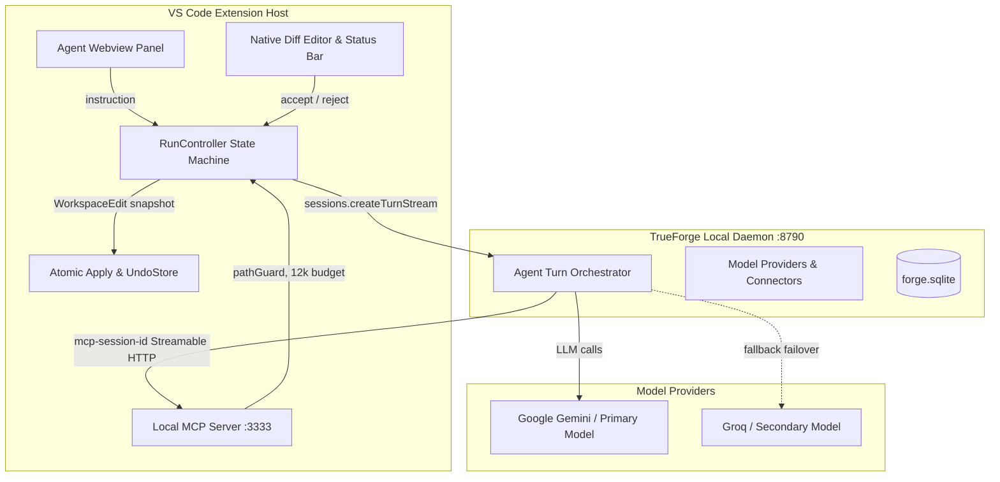

# Section 3 — Architecture on TrueForge

### Architectural Principles
1. **Isolated CommonJS/ESM Bridge**: The VS Code Extension Host (CommonJS) bridges with `@truefoundry/trueforge-sdk` through dynamic ESM imports, eliminating packaging conflicts.
2. **Streamable HTTP Session Multiplexing**: MCP endpoints `/mcp-core` and `/mcp-extra` on port 3333 maintain session state keyed on `mcp-session-id`, preventing "Server already initialized" conflicts across multi-turn agent runs.
3. **Approval-Driven Review**: Proposed edits trigger TrueForge `tool.approval_required` events, pausing the loop server-side while the user reviews the diff.
